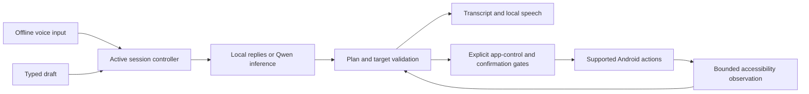
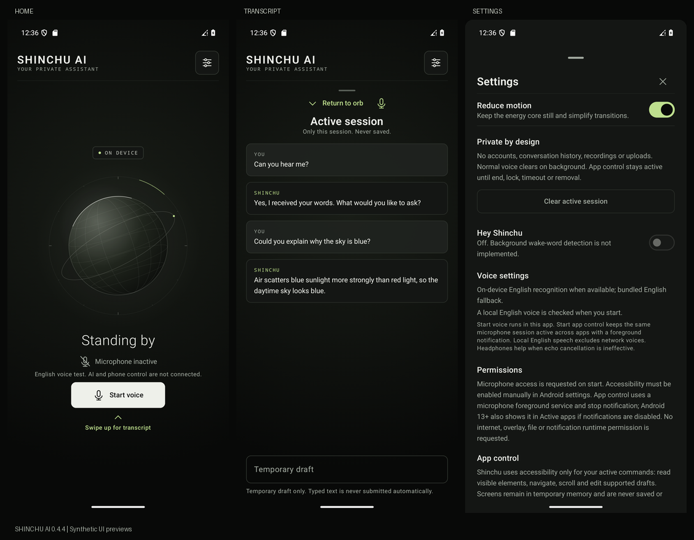

# SHINCHU AI

**An Android voice assistant combining local speech, local model inference and explicitly enabled app-control sessions.**

  

## The product boundary: useful assistance without a cloud session

Voice assistants often connect recognition, reasoning and actions to remote services. SHINCHU AI explores a device-local alternative: offline speech recognition, imported model weights, local speech output and temporary session state.

The application has no account flow, analytics or conversation-history database, and its manifest does not grant internet access. Initial dependency acquisition, offline voice installation and optional browser-based model acquisition are separate setup operations.

## A session-centered experience

| Capability | Inspected behavior |
| --- | --- |
| Voice input | On-device recognition when available, with bundled Vosk English fallback. |
| Local answers | Direct conversational replies and Qwen-based reasoning through llama.cpp. |
| Speech output | Local English text-to-speech with network voices excluded by the implementation. |
| Session UI | Orb states, transcript, settings and reduce-motion preferences. |
| App control | An explicit session enables supported launch, navigation, scrolling and draft editing actions. |
| Confirmation | Supported send actions require current target/draft checks and fresh confirmation. |
| Session limits | Cancellation, lock/background behavior and bounded active-session time. |

Normal voice and app-control sessions have different execution rights. Typed drafts remain unsent. Accessibility must be enabled manually through Android settings; unsupported or ambiguous screen targets fail explicitly.

## Architecture: speech, reasoning, validation, action

Kotlin and Compose handle application state and presentation. A C++/JNI bridge integrates the vendored llama.cpp engine. Vosk provides bundled recognition resources; the Qwen3-0.6B quantized model is imported separately and checked against a pinned size and SHA-256. Android foreground and accessibility services support explicitly active control sessions.

## Visual demonstration

This is the existing **synthetic design preview**, not a recording of a live inference session. Its fictional transcript and interface were visually reviewed for this draft. The current graphite design is shown without exposing device identifiers or personal conversations.

## Technical highlights and challenges

Running a model locally creates practical memory, ABI and latency constraints. The source has resource checks, model import validation and a JNI boundary; its documentation calls out 64-bit inference and device-memory requirements. Fast local command paths avoid model work for common instructions.

App automation introduces a second challenge: generated intent is not sufficient proof that a screen target is safe or correct. The implementation validates plans, observes supported targets and uses confirmation gates for supported sends. Compatibility is intentionally bounded rather than claiming arbitrary app control.

## Privacy, safety and delivery status

Temporary session data is cleared by the documented lifecycle paths. The application includes screen-capture protection and explicit microphone/accessibility setup. Third-party app compatibility, confirmation handling and live voice interruption still require physical-phone acceptance; no guarantee of delivery/read status is made.

Version 0.4.4 and Phase 4 functionality are represented in source and existing evidence. Earlier reports contain emulator and synthetic test evidence, not universal device certification. **Wake-word activation remains unimplemented.** Release signing is not configured; local debug APKs are development artifacts, and unsigned release output is not installable as a distributed release.

## Next milestones

- Measure physical-phone latency, RAM, battery, thermal behavior and voice interruption.
- Accept specific external-app profiles with controlled synthetic conversations.
- Review release signing and distribution separately.
- Investigate wake-word support against Android platform restrictions.

## Credits and model resources

Portfolio: [chiranjit-chakma](https://github.com/chiranjit-chakma). The project uses Android, Kotlin, Compose, Vosk, llama.cpp and Qwen. Vendored engine and model-license material are retained in the private preservation plan; third-party ownership is not claimed. The public repository contains this case study, diagrams and a reviewed design preview, with no application source or model weights.
